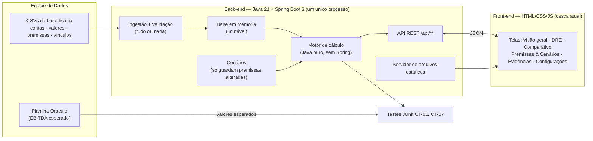

# Arquitetura — Plataforma Integrada de Projeção Orçamentária e EBITDA

Desafio Jovem Tech · Porto do Itaqui / EMAP · Proposta v1 — 17/11/2026
Base: PRD final (04/11), PoC v1.4 (15/10) e front-end existente em `Porto-Itaqui-v2/`.

> **Prazo real: 19/11 (limite operacional).** Toda decisão abaixo prioriza o que é possível entregar, testar e demonstrar em ~2 dias úteis. Nada aqui exige tecnologia nova para a equipe além do que já foi escolhido (Java no back-end, HTML/CSS/JS puro no front-end).

---

## 1. Diagnóstico do que já existe

### 1.1 Documentos
O PRD e o PoC estão bem alinhados. Os pontos que **ainda estão abertos** e afetam código:

| Pendência | Onde aparece | Como a arquitetura lida |
|---|---|---|
| Fórmula exata do EBITDA (tratamento de D&A, impostos) | RN001, PoC §15 | Fórmula isolada em **uma classe** (`CalculadoraEbitda`); a estrutura da DRE diz o papel de cada grupo. Mudar a regra = mudar um lugar. |
| Método de projeção dos períodos abertos | RN004 "método a validar" | Interface `RegraProjecao` com uma implementação padrão (seção 4.3). Trocável sem mexer no resto. |
| Data de corte (último mês fechado) | PoC §15 | Parâmetro de configuração da base (`data_corte`), não fixo no código. |
| Mapeamento índice → grupo | RN009 | Arquivo `vinculos.csv` da equipe de Dados. |

### 1.2 Código do front-end (`Porto-Itaqui-v2/Porto-Itaqui-main/Projeto Porto/`)
~5.700 linhas em HTML/CSS/JS puro, com Chart.js. **A qualidade de engenharia é boa**: código organizado por seções, acessibilidade (ARIA, `dialog`, foco), temas por CSS variables, escape de HTML, animações respeitando `prefers-reduced-motion`, exportação CSV e impressão.

**O problema é o domínio.** A aplicação implementa um sistema de *contas a pagar/receber* (lançamentos com cliente, CPF/CNPJ, parcelas, vencimento, situação pago/aberto). O PRD pede uma *DRE com orçado × realizado × forecast, EBITDA e cenários*. São modelos diferentes:

| Front atual | O que o PRD pede |
|---|---|
| Lançamento individual com cliente e vencimento | Valor mensal agregado por **conta/grupo da DRE** |
| Regime de caixa (pago/a pagar) | Regime de competência (orçado/realizado/projetado) |
| Saldo = receitas − despesas | EBITDA = receita líquida − custos − despesas operacionais |
| Dados no `localStorage` do navegador | Dados vindos do motor de cálculo (back-end), base única |
| Campos CPF/CNPJ, cliente, nº da conta | **Proibido** por RN008 / RNF005 (sem dados pessoais) |

**Decisão:** manter a *casca* (layout, design system, componentes, utilitários, roteador, gráfico) e **substituir as telas de domínio**. Detalhe na seção 6.

### 1.3 Back-end e Dados
Não há código de back-end nem arquivos da equipe de Dados na pasta. A arquitetura define os **contratos** (seção 5) para que as três frentes trabalhem em paralelo hoje.

---

## 2. Visão geral



Princípios:

1. **Um processo só.** O Spring Boot serve a API *e* os arquivos do front. Sem CORS em produção, sem banco, sem Docker obrigatório. `java -jar` e abre o navegador.
2. **O motor de cálculo é Java puro.** Sem anotações do Spring, sem acesso a arquivo. Recebe dados, devolve números. É o que os testes exercitam.
3. **Isolamento por construção, não por cuidado.** O orçamento original e o realizado são imutáveis depois de carregados. Um cenário **não guarda valores**, só as premissas que diferem do original; tudo é recalculado a cada consulta. Assim é *impossível* um cenário sobrescrever o orçamento (RN006, RF009) ou um realizado fechado (RN003, RF008).
4. **Recalcular sempre, nunca cachear.** A base tem algumas dezenas de contas × 48 meses (2024–2027). Recalcular tudo leva milissegundos, muito abaixo dos 3 s (RNF002). Cache só traria risco de inconsistência.

---

## 3. Stack

| Camada | Escolha | Por quê |
|---|---|---|
| Back-end | **Java 21 + Spring Boot 3** (`spring-boot-starter-web`, `-validation`), Maven | Java já decidido no PoC (§10.1). Spring Boot dá API REST + servidor estático com quase nenhuma configuração. |
| Valores monetários | `BigDecimal` | Evita erro de ponto flutuante: o CT-01 exige divergência zero contra a planilha. |
| Leitura de CSV | Apache Commons CSV | Simples, sem mágica. |
| Persistência | **Em memória**, carregada dos CSVs na inicialização; cenários salvos em `dados/cenarios.json` | PRD exclui banco/infra. Arquivo JSON evita perder cenários ao reiniciar ("sem perda de dados", entrega do Alexandre). |
| Testes | JUnit 5 + AssertJ, testes parametrizados lendo o CSV do Oráculo | Gera a evidência que o RF011 e a Matriz de Evidências pedem. |
| Front-end | **HTML/CSS/JS puro + Chart.js 4.4.3** (o que já existe) | Reescrever em framework agora não cabe no prazo e não traz ganho para a demo. |

---

## 4. Back-end

### 4.1 Estrutura de pastas

```
backend/
  pom.xml
  src/main/java/br/jovemtech/itaqui/
    Aplicacao.java
    dominio/           # records imutáveis, sem lógica de infraestrutura
      Conta.java  TipoConta.java  Periodo.java  TipoValor.java
      Premissa.java  Vinculo.java  Cenario.java  Base.java
    calculo/           # MOTOR — Java puro, 100% testável
      RegraProjecao.java            (interface)
      ProjecaoPorIndice.java        (implementação padrão)
      MotorForecast.java            (orçado/realizado/projetado/forecast por conta×mês)
      AgregadorDre.java             (soma hierárquica)
      CalculadoraEbitda.java        (fórmula — ÚNICO lugar)
      ResultadoDre.java             (saída do motor)
    dados/
      CarregadorCsv.java            (lê os 5 arquivos)
      ValidadorBase.java            (RF002 / RNF001 / CT-07)
      RepositorioBase.java          (guarda a Base imutável)
      RepositorioCenarios.java      (memória + cenarios.json)
    api/
      MetaController  DreController  PremissaController
      CenarioController  ImportacaoController  EvidenciaController
      dto/  TratadorErros.java
  src/main/resources/
    application.properties
    dados/             # CSVs fictícios entregues pela equipe de Dados
  src/test/java/...
    calculo/  CT01_CalculoBaseTest ... CT07_IntegridadeDadosTest
  src/test/resources/oraculo/esperado.csv
```

### 4.2 Modelo de domínio

```
Conta        codigo, nome, codigoPai, tipo (TipoConta), opex (bool), ordem
TipoConta    RECEITA_BRUTA | DEDUCAO_RECEITA | CUSTO | DESPESA_OPERACIONAL
             | DEPRECIACAO_AMORTIZACAO | GRUPO (só agrega filhos)
Periodo      ano, mes            → comparável; fechado = periodo <= dataCorte
Valor        codigoConta, periodo, tipo (ORCADO | REALIZADO), valor (BigDecimal)
Premissa     codigo, nome (ex.: IPCA, Reajuste salarial), percentual por Periodo
Vinculo      codigoConta → codigoPremissa, vigenciaInicio (Periodo)
Base         contas, valores, premissas, vinculos, dataCorte, origem ("FICTÍCIO")
Cenario      id, nome, somenteLeitura, ajustesPremissas: Map<codigoPremissa, Map<Periodo, %>>
```

- O cenário **"Original"** (id `original`) é criado automaticamente, `somenteLeitura = true`, sem ajustes. A API recusa qualquer alteração nele (HTTP 409).
- Valores sempre positivos no arquivo; o **sinal vem do `TipoConta`** (dedução, custo e despesa subtraem). Isso evita o erro clássico de sinal trocado na planilha.

### 4.3 Motor de cálculo

Para cada conta folha `c`, mês `m` e cenário `s`:

```
orcado(c,m)    = valor ORCADO carregado                  (nunca muda)
realizado(c,m) = valor REALIZADO carregado, se m fechado  (nunca muda)

projetado(c,m,s) =
    se c não tem vínculo vigente em m  → orcado(c,m)                       (RN005 / CT-04)
    senão                              → RegraProjecao.aplicar(orcado(c,m), premissas(s, c, m))

forecast(c,m,s) = m fechado ? realizado(c,m) : projetado(c,m,s)            (RF007 / RN003)
```

**Regra implementada (`ProjecaoPorIndice`)** — *a validar com GFin / Oráculo do Murilo*:
`projetado = orcado × (1 + índice_cenário/100) / (1 + índice_original/100)` (no Excel: `=ORCADO*(1+NOVO/100)/(1+ORIG/100)`).
Ou seja: o orçamento já embute o índice original; o cenário troca esse índice pelo novo. Com mais de uma premissa na mesma conta, os fatores se multiplicam. No cenário Original o fator é 1, então `projetado == orcado` (sanidade óbvia para a banca). Se a GFin preferir outra regra (composta, sobre o último realizado etc.), troca-se só esta classe.

Agregação e indicadores (`AgregadorDre`, `CalculadoraEbitda`):

```
Receita Líquida = Receita Bruta − Deduções
EBITDA          = Receita Líquida − Custos − Despesas Operacionais     (D&A excluída)
Margem EBITDA   = EBITDA / Receita Líquida  (null se Receita Líquida = 0)
```

Calculados para as três perspectivas (orçado, realizado acumulado até o corte, forecast) por mês e no total do ano. Arredondamento: cálculo em precisão cheia, **arredonda só na saída para 2 casas com `HALF_UP`** (igual ao `ARRED` do Excel, para bater com o Oráculo).

### 4.4 API REST

> **Implementada** em `backend/`. A lista completa e atualizada de rotas (incluindo PATCH de cenário, DELETE de conta/vínculo/ajuste, `/api/cenarios/{id}/premissas`, exportação dos CSVs da base, restauração e `/api/evidencias/desempenho`) está em [backend/README.md](backend/README.md).

Todas as respostas JSON incluem `"origemDados": "FICTICIO"` (RF012) e as de cálculo incluem `"tempoCalculoMs"` (evidência do CT-06).

| Método | Rota | Uso | Requisito |
|---|---|---|---|
| GET | `/api/meta` | data de corte, anos disponíveis, origem dos dados, versão da base | RF012 |
| GET | `/api/dre/estrutura` | árvore de contas | RF001 |
| POST | `/api/dre/contas` | cadastrar conta/classe de custo | RF001 (entrega Antony) |
| GET | `/api/premissas` | índices e valores por período (originais) | RF003 |
| GET / POST | `/api/vinculos` | consultar / criar vínculo conta → premissa | RF004 |
| GET | `/api/cenarios` | lista (sempre inclui `original`) | RF009 |
| POST | `/api/cenarios` | cria cenário a partir do original `{nome}` | RF009 |
| PUT | `/api/cenarios/{id}/premissas/{codigo}` | altera premissa no cenário `{periodo, percentual}` (409 se `original`) | RF003, RF009 |
| DELETE | `/api/cenarios/{id}` | remove cenário (409 se `original`) | — |
| GET | `/api/cenarios/{id}/dre?ano=2026` | **resposta principal**: matriz conta × mês com orcado/realizado/projetado/forecast, status do mês, totais, EBITDA, margem, flag OPEX | RF005–RF008, RF010 |
| GET | `/api/cenarios/{id}/comparativo?ano=2026&base=original` | diferenças por conta/mês entre dois cenários | RF009, CT-05 |
| POST | `/api/importacao` | upload dos CSVs; valida tudo e **só substitui a base se não houver erro**; devolve lista de erros linha a linha | RF002, RNF001, CT-07 |
| GET | `/api/evidencias/dre.csv?cenario=&ano=` | exporta o resultado no mesmo layout do Oráculo | RF011 |

Formato resumido de `/api/cenarios/{id}/dre`:

```json
{
  "cenario": "original", "ano": 2026, "dataCorte": "2026-09",
  "origemDados": "FICTICIO", "tempoCalculoMs": 4,
  "meses": [{"mes": 1, "status": "FECHADO"}, ..., {"mes": 12, "status": "ABERTO"}],
  "linhas": [
    {"codigo": "3.1", "nome": "Receita Bruta", "nivel": 0, "tipo": "RECEITA_BRUTA", "opex": false,
     "valores": [{"mes": 1, "orcado": 100.00, "realizado": 98.50, "projetado": null, "forecast": 98.50}, ...],
     "total": {"orcado": ..., "realizado": ..., "forecast": ...}}
  ],
  "indicadores": {
    "receitaLiquida": {"orcado": ..., "realizado": ..., "forecast": ...},
    "ebitda":         {"orcado": ..., "realizado": ..., "forecast": ...},
    "margemEbitda":   {"orcado": ..., "realizado": ..., "forecast": ...}
  }
}
```

Erros seguem um formato único (`TratadorErros`): `{"erro": "CODIGO", "mensagem": "...", "detalhes": [...]}`.

---

## 5. Contrato de dados (equipe de Dados ↔ Back-end)

CSV com separador `;`, UTF-8, cabeçalho obrigatório, decimal com **vírgula ou ponto** (aceitar os dois — vem do Excel brasileiro). Valores sempre positivos.

| Arquivo | Colunas |
|---|---|
| `config.csv` | `chave;valor` → `data_corte;2026-09`, `origem;FICTICIO`, `versao;1` |
| `contas.csv` | `codigo;nome;codigo_pai;tipo;opex;ordem` |
| `valores.csv` | `codigo_conta;ano;mes;tipo;valor` (tipo = `ORCADO` ou `REALIZADO`) |
| `premissas.csv` | `codigo;nome;ano;mes;percentual` (ex.: `IPCA;IPCA;2026;10;0,45`) |
| `vinculos.csv` | `codigo_conta;codigo_premissa;vigencia_inicio` (ex.: `4.2.1;IPCA;2026-10`) |

Regras de validação (cada uma vira um caso do CT-07):
- código de conta duplicado; `codigo_pai` inexistente; `tipo` desconhecido;
- valor de conta `GRUPO` (grupos só agregam);
- `REALIZADO` em mês **aberto** (depois do corte) → erro;
- mês fora de 1–12, valor negativo ou não numérico;
- vínculo para conta ou premissa inexistente.

**Oráculo (Murilo):** além da planilha, exportar `esperado.csv` com `cenario;ano;mes;indicador;perspectiva;valor`. Os testes JUnit leem esse arquivo e comparam com o motor — é a prova automática do CT-01/CT-02/CT-03.

---

## 6. Front-end — o que fica, o que muda

### 6.1 Mantido (trabalho da equipe preservado)

- `style.css` inteiro: tokens, 4 temas, cards, `stat`, tabelas, `dialog`, toast, responsividade, impressão.
- Casca do `index.html`: topbar, sidebar, overlay mobile, `page-header` + breadcrumb.
- De `script.js`: utilitários (`fmtMoeda`, `fmtData`, `escapar`, `porcentagem`, `fmtPct`, `animarNumero`, `mostrarNumero`), toast (`mostrarAviso`), `confirmar`, `baixarArquivo`, tema (`aplicarTema`), menu/dropdowns, **roteador por hash** (`ROTAS`, `rotear`, `irPara`), `tooltipExterno` e a configuração do Chart.js, exportar CSV e imprimir, aba Aparência das Configurações.

### 6.2 Removido ou substituído (e por quê)

| Item | Motivo |
|---|---|
| Tela **Lançamentos** + formulário (cliente, CPF/CNPJ, nº da conta, parcelas, vencimento) | Domínio errado e **dados pessoais vetados** (RN008/RNF005). Vira a tela **DRE**. |
| Tela **Histórico** (pagos/cancelados) | Não existe no PRD. Vira **Evidências** (reaproveita filtros, tabela, CSV, impressão). |
| Cards "Saldo / A receber / A pagar / Vencidos" | Regime de caixa. Viram cards de **EBITDA / Margem / Desvio**. |
| `localStorage` como fonte de dados + `SEED_BRUTO` | Os dados devem vir da base única do back-end. `localStorage` fica só para preferências (tema, menu recolhido). |
| Abas Perfil e Segurança (senha), menu "Sair", chip "UG", seletor Matriz/Filial | Autenticação está **fora do escopo** (PRD §4.2). Simular login em demo para cliente passa impressão falsa. |

### 6.3 Telas finais (mapeadas às entregas do PRD)

| Rota | Tela | Responsável (PRD §8) | Requisitos |
|---|---|---|---|
| `#inicial` | **Visão geral**: EBITDA e margem orçado × forecast, desvio, data de corte, seletor de cenário | Izabelle | RF005, RF006 |
| `#dre` | **DRE**: tabela hierárquica conta × mês, meses fechados com cadeado e fundo distinto, abertos editáveis via cenário | Izabelle / Hugo | RF001, RF006–RF008 |
| `#comparativo` | **Painel triplo**: orçado (barra) × realizado (barra) × forecast (linha, tracejada nos meses abertos); variação %; OPEX destacado | Hugo | RF006, RF010 |
| `#cenarios` | **Premissas & Cenários**: lista de índices, edição por mês, criar cenário, alternar Original ↔ Simulado, diff lado a lado | Samuel | RF003, RF004, RF009 |
| `#evidencias` | **Evidências**: exportar DRE/indicadores em CSV no layout do Oráculo, tempo de cálculo, imprimir | Ryan (uso) | RF011 |
| `#configuracoes` | Importar base (com lista de erros) + Aparência | Kayo | RF002, CT-07 |

Transversal (Kayo): **selo fixo "DADOS FICTÍCIOS — DEMONSTRAÇÃO"** na topbar e em todo CSV/impressão (RF012); estados de carregamento; erro da API em toast; validação dos formulários de premissa (% numérico, faixa razoável) antes de enviar.

### 6.4 Organização dos arquivos

Sem build, sem framework — só separar o `script.js` de 2.300 linhas para quatro pessoas não editarem o mesmo arquivo:

```
frontend/
  index.html
  css/style.css
  img/IconEmap.png
  js/
    base.js          # utilitários, toast, confirmar, tema, menu, roteador (extraídos do script.js atual)
    api.js           # única porta para o back-end; modo MOCK lendo mock/*.json
    estado.js        # cenário selecionado, ano, dados da última resposta
    telas/
      inicial.js  dre.js  comparativo.js  cenarios.js  evidencias.js  configuracoes.js
    main.js          # registra as telas no roteador e inicializa
  mock/
    meta.json  dre-original-2026.json  cenarios.json  premissas.json
```

Carregados com `<script>` em ordem (sem módulos ES).

> **Implementado** em `frontend/` (detalhes em [frontend/README.md](frontend/README.md)). Como a API ficou pronta antes, o modo MOCK não foi necessário: o front fala direto com o back-end. Também entrou `js/graficos.js` (gráfico triplo compartilhado) e `css/app.css` (estilos novos; o `style.css` original ficou intacto).

O Spring Boot serve esta pasta (`spring.web.resources.static-locations=file:../frontend/,classpath:/static/`); para a entrega final, o Maven copia `frontend/` para dentro do `.jar`. Em desenvolvimento, CORS liberado só para `localhost`/`127.0.0.1` (Live Server).

---

## 7. Rastreabilidade: casos de teste → onde são provados

| CT | Prova automática (JUnit) | Prova visual (demo) |
|---|---|---|
| CT-01 Cálculo base | `CalculadoraEbitda` × `esperado.csv` | Visão geral = planilha |
| CT-02 Forecast | `MotorForecast`: Σ realizado fechado + Σ projetado aberto | Tabela DRE, coluna total |
| CT-03 Recálculo por premissa | altera IPCA no cenário → só contas vinculadas e meses abertos mudam | Diff na tela Cenários |
| CT-04 Conta sem premissa | conta sem vínculo: projetado == orçado | idem |
| CT-05 Cenário isolado | após editar cenário, `/cenarios/original/dre` idêntico ao inicial; PUT no original → 409 | Alternar Original ↔ Simulado |
| CT-06 Desempenho | teste mede o cálculo completo < 3 s (esperado: < 50 ms) | `tempoCalculoMs` na tela Evidências |
| CT-07 Integridade | um teste por regra da seção 5 | Importar CSV com erro → lista de erros, base anterior mantida |

---

## 8. Plano de execução (17 → 19/11)

| Quando | Back-end (Antony, Alexandre) | Front-end (Izabelle, Hugo, Samuel, Kayo) | Dados (Murilo, Kauane, Ryan) |
|---|---|---|---|
| **17/11 tarde** | Projeto Spring Boot criado; domínio (records); acordar JSON da seção 4.4 | Criar `frontend/`, extrair `base.js`, remover telas antigas, criar `api.js` com mock | Kauane: CSVs no formato da seção 5. Murilo: Oráculo + `esperado.csv` |
| **18/11** | Antony: motor + `/dre`, `/cenarios`. Alexandre: carregador/validador + `/importacao` + `cenarios.json` | Cada um na sua tela contra o mock; Kayo no selo, loading e erros | Ryan escreve os CT-01..07 em JUnit junto com o back-end |
| **19/11 manhã** | Integração real (desligar MOCK); corrigir divergências | Integração; acabamento visual | Executar matriz de evidências; relatório de qualidade |
| **19/11 ~14h** | **Code freeze** | **Code freeze** | Ensaio da demo (Ruanne) |

Antes de tudo: **criar um repositório git único** (`backend/`, `frontend/`, `dados/`, `docs/`). Hoje a pasta não é um repositório e há duas cópias do front (`projeto-porto-itaqui/` só tem README; `Porto-Itaqui-v2/` tem o código).

---

## 9. Decisões que precisam de "ok" da PO / GFin

1. **Regra de projeção** (seção 4.3) — proposta: orçado × (1 + Δ índice). Murilo deve montar o Oráculo com a mesma regra.
2. **D&A fora do EBITDA** e **deduções** como impostos sobre receita — confirmar com a máscara da DRE.
3. **Data de corte da demo**: sugerida `2026-09` (exemplo do próprio PoC).
4. **Remover as abas Perfil/Segurança/Sair e o seletor de unidade** do front atual.
